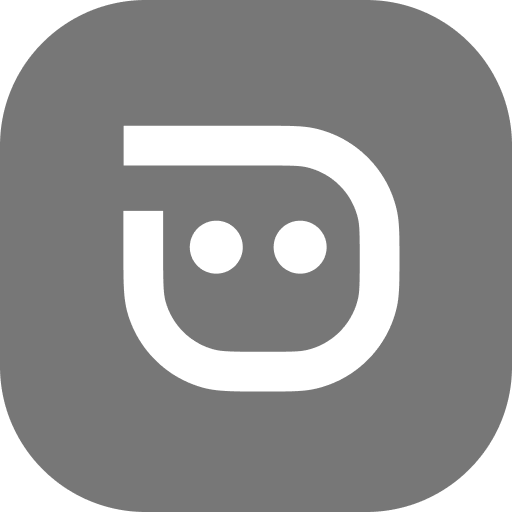
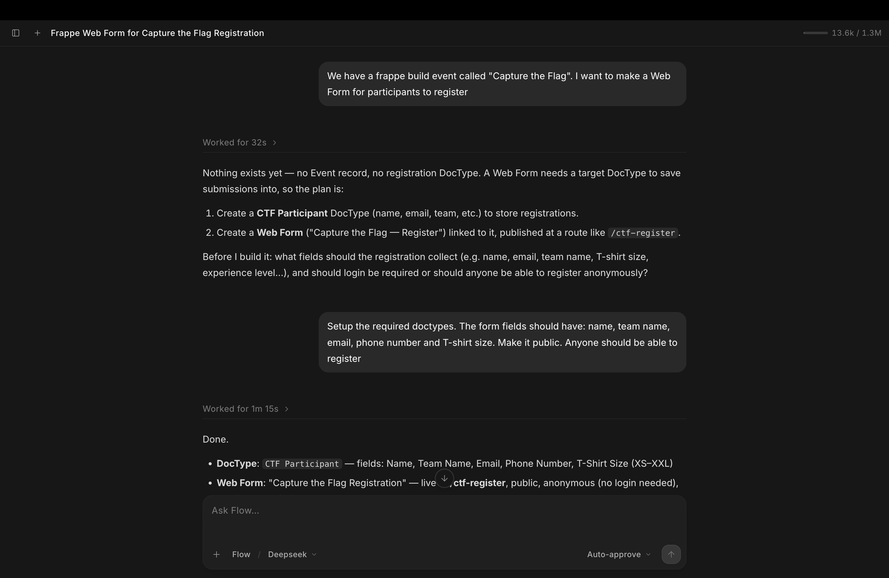

<div align="center">
    <a href="https://github.com/frappe/flow">
        
    </a>
    <h2>Flow</h2>
    <p>AI agents for Frappe.</p>

[](https://www.gnu.org/licenses/agpl-3.0)
[](https://github.com/frappe/flow/actions/workflows/ci.yml)

</div>



---

Flow puts an AI assistant inside your Frappe site. It knows your DocTypes, respects your permissions, and can operate your site in plain English — creating records, sending emails, building DocTypes, creating agents and tools, and setting up RAG chatbots.

**Set up a support agent:**
> *"Create an agent that resolves customer support issues. It should use the Support Ticket doctype and these files as its knowledge: [attach files]"*

Flow sets up the RAG pipeline, embeds and indexes the files, and keeps the DocType source in sync — automatically.


**Put reporting on autopilot:**
> *"Every weekday at 9am, email me a summary of yesterday's new leads with their contact details and source."*

**Do anything a user can do:**
> *"Find all overdue sales orders from last month and mark them as closed."*

---

## Framework

Flow also ships as a Python framework for building agents in code.

### Define a tool

```python
import frappe
from flow import ToolContext, tool

@tool
def get_open_todos(allocated_to: str, *, ctx: ToolContext) -> list[dict]:
	"""List open ToDo items for a user."""
	return frappe.get_list(
		"ToDo",
		filters={"allocated_to": allocated_to, "status": "Open"},
		fields=["name", "description", "status"],
	)
```

### Run an agent

```python
from flow import Agent

agent = Agent(
	name="Todo Assistant",
	model="Claude Sonnet 4.6",  # a Flow Model
	instructions="You help with Frappe tasks.",
	tools=[get_open_todos],
)

run = agent.run("List open ToDo items assigned to me")
```

```python
# myapp/ai.py
def agents():
	return [agent]


# hooks.py
flow_agents = ["myapp.ai.agents"]
```

### Act when a run ends

```python
# Flow calls myapp.ai.save_draft(run) when the run ends.
agent.run("Draft a reply to ticket 42", on_complete="myapp.ai.save_draft")
```

### Share a tool with agents made in the desk

```python
# hooks.py
flow_tools = ["myapp.ai.get_open_todos"]
```

### Manage sessions

```python
session = agent.new_session(title="Todo assistant")
# Or continue one: session = flow.lib.session.load_session(session_name)

session.chat("What tasks do I have open?")
session.chat("Close the ones due before last Friday.")
```

---

## Installation

Install into an existing [bench](https://github.com/frappe/bench):

```bash
cd $PATH_TO_YOUR_BENCH
bench get-app flow
bench --site site-name install-app flow
```

Then add a `Flow Provider` with your API key and a `Flow Model` with a model ID such as `anthropic/claude-sonnet-4-6`, and open `/flow` to start. For local providers like Ollama or LM Studio, set `Base URL` on the provider or model.

### Flow agent harness

Conversations run on the flow agent harness, a daemon from the [`frappe-flow`](https://pypi.org/project/frappe-flow/) package that is shared by every site on the bench. Installing the app starts it; `bench flow-server setup|start|stop|restart|status` manage it by hand. Its log is at `<bench>/logs/flow-server.log`.

To run it under Supervisor, set `"flow_server_manager": "supervisor"` in `common_site_config.json` and add `bench flow-server serve` as a Supervisor program that logs to `logs/flow-server.log`. Restart that program after updating Flow or its extensions.

## Repository layout

The Frappe app is the root of this repository. [`harness/`](harness/) is the flow agent harness, published on PyPI as [`frappe-flow`](https://pypi.org/project/frappe-flow/). For development, install the checkout into the bench:

```bash
bench pip install -e apps/flow/harness
```

## License

[GNU AGPLv3](license.txt)
