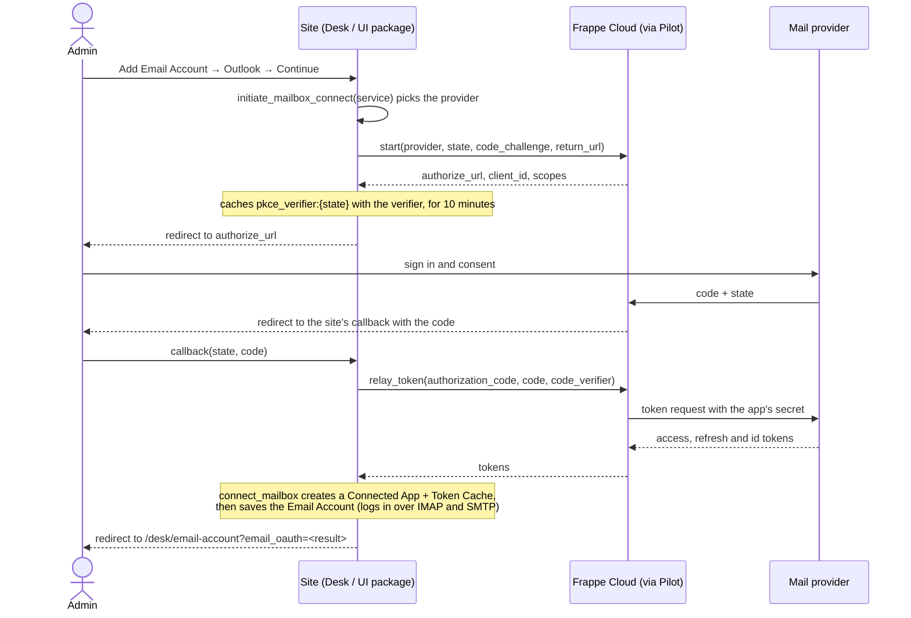

# Frappe Cloud providers

## One-click mailbox sign-in (`email_oauth.py`)

On a Frappe Cloud site (`is_v2_site()`), an admin adds a mailbox by signing in with its provider instead of typing an app password.

The host app's boot lists the services that can sign in this way (`get_one_click_services()`, as `one_click_email_services`). For one of them, Desk's Add dialog offers "Continue", which signs in with the provider, or "Set up manually" (the normal Email Account form); the UI package signs in straight from the service's tile. Continuing calls `initiate_mailbox_connect(service)`, which returns the provider's sign-in link, or `None` when the site isn't on Frappe Cloud, no provider in `ONE_CLICK_PROVIDERS` has that service, or Frappe Cloud reports the provider unavailable; on `None` both open the form. Any other error, such as Pilot being unreachable, is shown as an error.

Reconnecting a signed-out mailbox (`initiate_mailbox_connect(email_account=...)`) takes the provider from its Connected App's Token URI and never falls back to the form; it fails with a message instead. Frappe Cloud owns the OAuth app at each provider and keeps its secret. The site never sees it: it reaches Frappe Cloud through its own Pilot (`PilotClient`) and keeps only the PKCE verifier and, once connected, the mailbox's tokens.

### Connecting a mailbox

The Connected App's Token URI is `frappe-cloud-relay:<provider>`. When its access token expires, `ConnectedApp.get_active_token` sees that prefix and refreshes through `relay_refresh`, which is `relay_token` with `grant_type=refresh_token`.

The result in the landing URL (`connected`, `cancelled`, `smtp_disabled`, ...) is turned into a message by `show_email_oauth_result` in Desk (`email_account_list.js`) and by `oauthMessage` in the UI package (`ui/src/components/EmailAccounts/services.ts`).

### Naming

A provider has three names, each with its own job:

| Name | Rule | Microsoft | Yahoo | Used in |
|---|---|---|---|---|
| Key | Company name, lower case | `microsoft` | `yahoo` | `Provider`, `ONE_CLICK_PROVIDERS`, and the Token URI `frappe-cloud-relay:<key>`. Never change it: connected mailboxes store it. |
| Label | Company name as written | Microsoft | Yahoo | The Connected App's name, and the "isn't available" and "only available on Frappe Cloud" messages |
| Service | Email Account's existing option, unchanged | `Outlook.com` | `Yahoo Mail` | What the admin picks, and Email Account's `service` field, stored on every account |

The key names whom you sign in with; the service names the mail product. They differ for Microsoft: work (Microsoft 365) and personal mailboxes both use the "Outlook.com" service.

### Adding a provider

The provider must return an `id_token` with an `email` or `preferred_username` claim, and accept XOAUTH2 over IMAP and SMTP. Desk and the UI package keep no list of providers, so only the backend changes:

1. In `frappe/integrations/frappe_providers/email_oauth.py`:
   - Add the key to `Provider`.
   - Add an entry to `ONE_CLICK_PROVIDERS`:
     - `label`: used in the Connected App's name and in sign-in messages.
     - `service`: the Email Account `service` option this provider signs in. One provider per service.
     - `servers`: `email_server` and `smtp_server`.
     - Optional `personal_tenant` and `personal_servers`, for providers whose personal accounts use other servers.
     - Optional `admin_approval_errors`: codes in the provider's error description that mean an admin must approve the app.
2. **New result codes**, if `connect_mailbox` returns any: add their text to both `show_email_oauth_result` (`email_account_list.js`) and `oauthMessage` (`ui/src/components/EmailAccounts/services.ts`).
3. **Tests**: `frappe/tests/test_email_oauth.py`, plus `ui/src/components/EmailAccounts/tests/` for any new result code.
